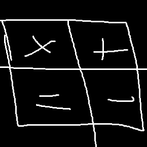

<h1 align="center">ChatCalc1710</h1>

Adds an ingame calculator for Minecraft 1.7.10 (Forge). Client side only.

> [!IMPORTANT]
> Dependency: [UniMixins](https://github.com/LegacyModdingMC/UniMixins)

## Normal Calculator
`3+3 -> TAB -> 6`

Supports `+ - * / ^`, parentheses, `sqrt`, `sin`, `cos` and `tan`.

## Stack Calculator
Type a number and add "s" to the end of it (e.g 1234s) and then press the tab key.\
There is also a double chest calculator. Use it the same way with "dc".

`1234s -> TAB -> 19 (Stacks) + 18 (Items)`

`5000dc -> TAB -> 1 (Double Chest) + 24 (Stacks) + 8 (Items)`

## Credits
- https://github.com/jrddp/ChatCalc
- https://github.com/backslashashley/ChatCalc112
- https://github.com/TomB-134/StackCalc
